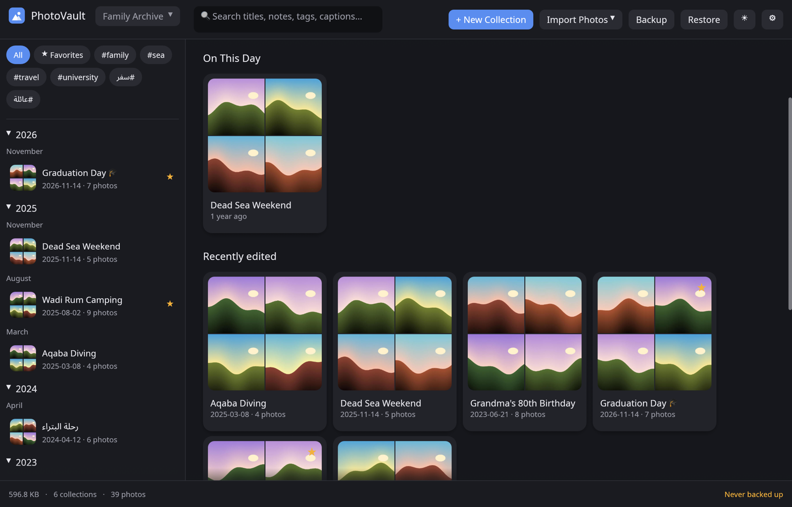
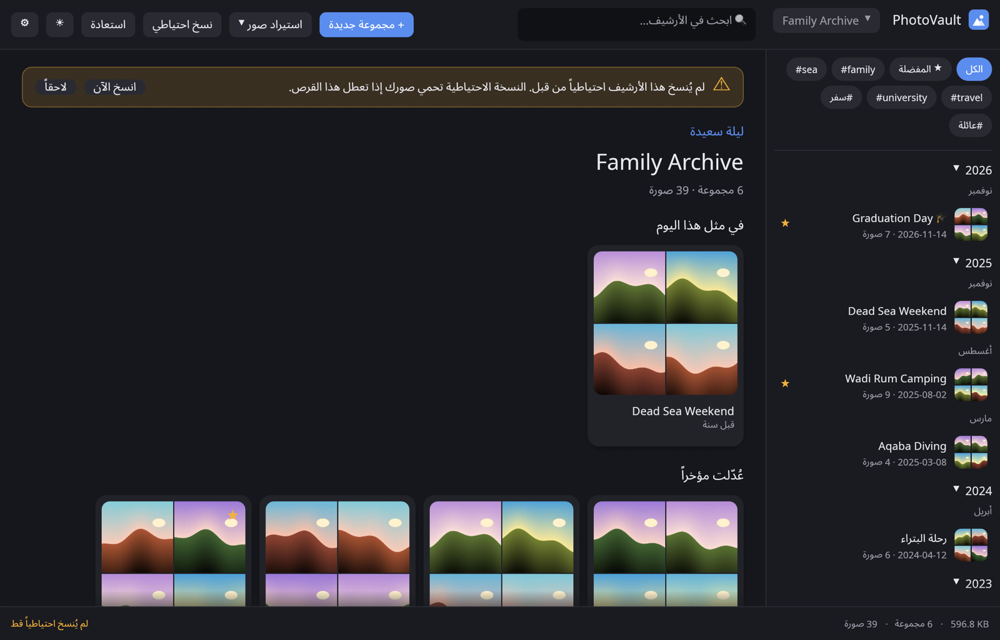
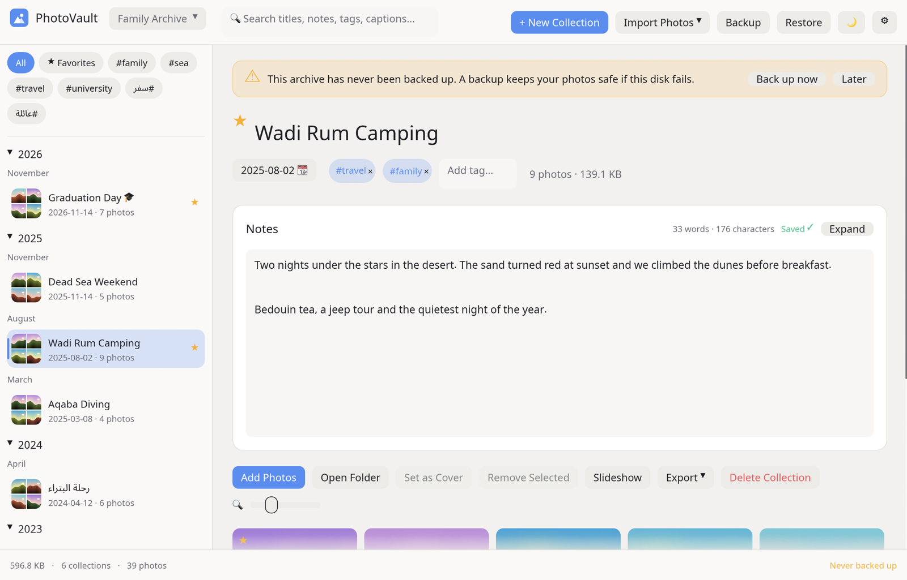
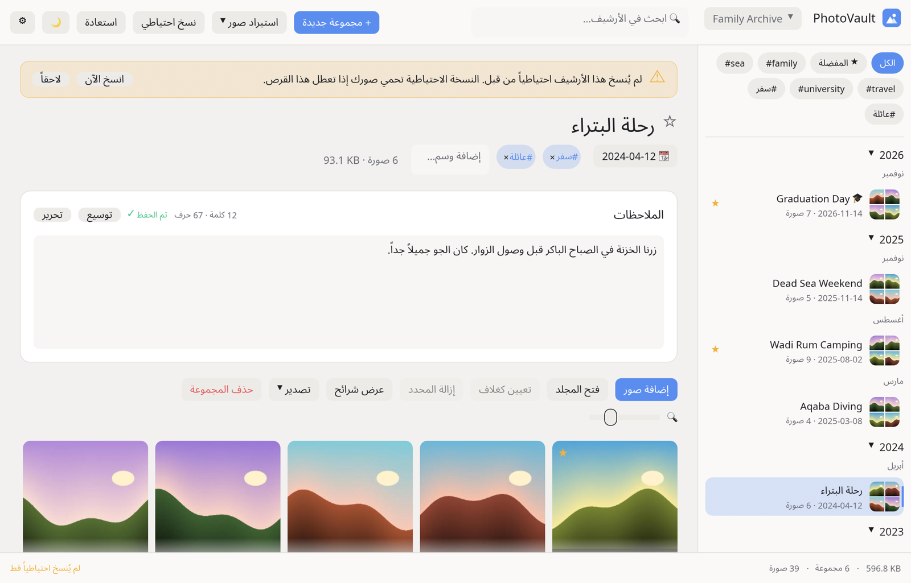
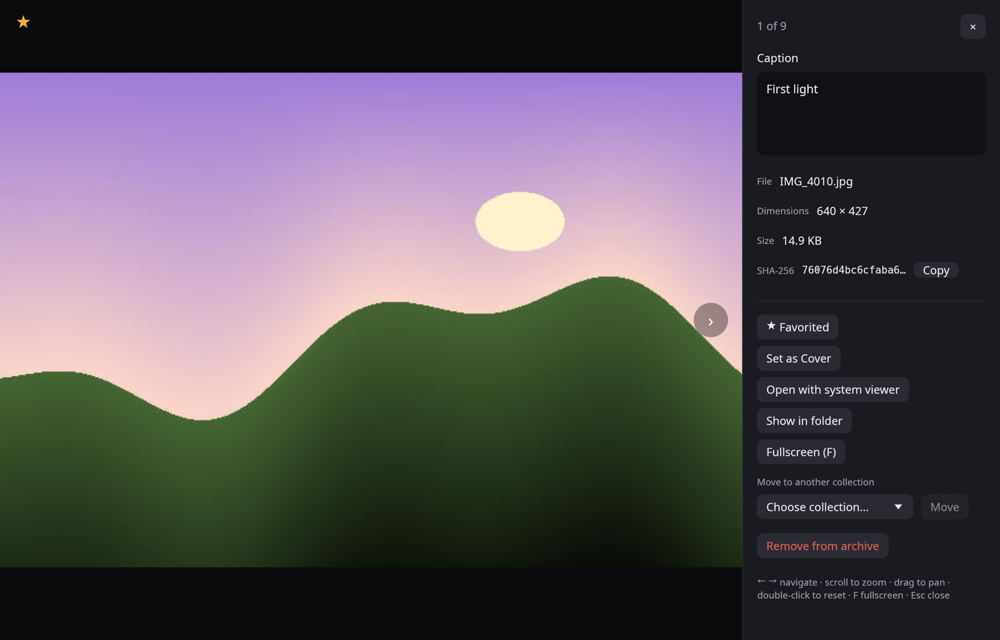
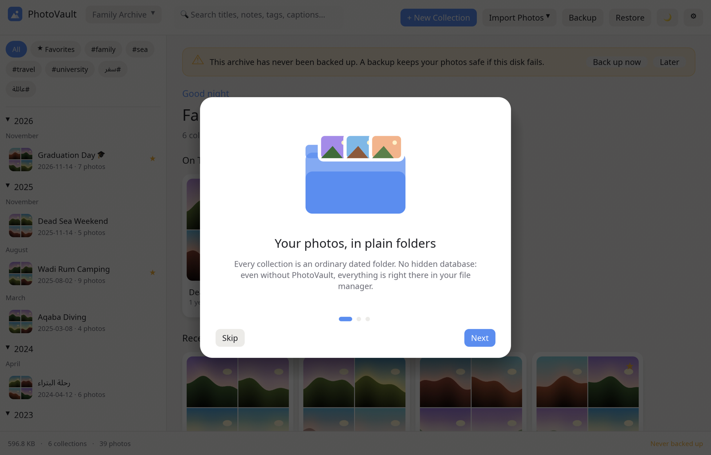
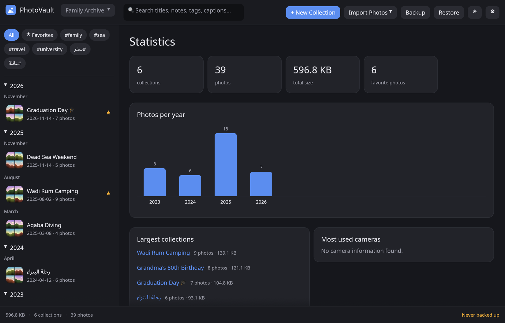

# PhotoVault

PhotoVault is a calm, cross-platform desktop app for archiving photos into
dated **collections**. Each collection has a title, a date, tags and long-form
notes. **The folder is the database:** everything lives in a plain folder of
photos, JSON and Markdown, so your memories outlive the app.

Written in Rust with [egui](https://github.com/emilk/egui). It runs on
Windows, macOS and Linux as a single binary.



| Arabic interface (right-to-left) | Light theme |
|---|---|
|  |  |
|  |  |

| First-run introduction | Statistics |
|---|---|
|  |  |

## Principles

1. **The folder IS the database.** No hidden database. Delete the app, point a
   fresh install (or a file manager) at the folder, and everything is there.
2. **Never lose a photo.** Imports *copy* originals and never move them.
   Every metadata write is atomic (temp → fsync → rename). Every photo is
   SHA-256 hashed and can be verified.
3. **Backups are standard `.zip` files** with a `README.txt`. They open on any
   OS without PhotoVault.
4. **Calm UI.** Dark theme by default, a single accent color, and all heavy
   work runs on background threads.

## Features

**Archive**
- Create a new archive, open an existing one, or adopt a folder of
  `YYYY/YYYY-MM-DD - Title` folders that was made by hand.
- Timeline sidebar grouped by year → month, with filter chips (All,
  Favorites, tags) and cover thumbnails (a 2×2 mosaic when no cover is set).
- Editable title (the folder is renamed when the field loses focus), date
  picker (moves the folder to the right year), tags, favorite flag.
- Notes editor for very long text, with word/character counts and debounced
  auto-save ("Saving… / Saved ✓").
- Orphan files are adopted automatically; missing files are flagged in amber.
- Removing photos or collections moves them to `.trash/` with a 10-second
  **Undo**. Settings → Empty trash.

**Import**
- Pick files, import a whole folder (recursive), or drag and drop onto the window.
- Single pass copy + SHA-256, fsync, temp name → final name, original mtime preserved.
- Duplicate detection: skipped within the same collection. For files that
  already exist in another collection you can Skip, Import anyway or Show
  existing, with "apply to all".
- Date suggestion from EXIF `DateTimeOriginal` (fallback: file dates), title
  suggestion from the folder name, and **"Split into one collection per day"**.
- Progress modal with files/s and Cancel. A cancelled import never leaves
  partial files.
- Previews `jpg jpeg png gif bmp webp tif tiff`. Archives without preview
  `heic heif avif dng cr2 cr3 nef arw raf orf rw2 mp4 mov` (generic tile with a
  format badge).

**Viewing**
- Responsive, lazily loaded thumbnail grid with shimmer placeholders and a size slider.
- Multi-select: Ctrl/⌘-click, Shift-click range, Ctrl/⌘+A. Right-click to
  reorder, move to another collection, set cover or remove.
- Lightbox: EXIF orientation, ←/→, wheel zoom around the pointer, drag to pan,
  `F` fullscreen, `Esc`. Neighbouring photos are preloaded.
- Info panel: caption, names, date taken, camera, size, dimensions, SHA-256
  (copy), GPS with an *Open in OpenStreetMap* link.
- Slideshow with caption overlay and interval control.

**Find & explore**
- Global search across titles, notes, tags, captions and file names
  (case-insensitive, Unicode-aware) with highlighted snippets. Filters for
  date range, favorites and tag.
- Home: **On This Day**, recently edited, favorites, and a backup reminder banner.
- Statistics (photos per year chart, largest collections, cameras) and a
  photo map list of GPS-tagged collections.

**Backup, restore, integrity**
- Streaming zip backup (memory stays flat for archives of 50 GB and more,
  zip64 when needed) with an optional **verify after writing** pass.
- **Incremental backups** ("only changes since the last backup").
- Restore with preview, version check, **zip-slip protection**, per-file
  SHA-256 verification in a staging folder, and an atomic move into place.
  Failing files are reported by name and nothing is changed.
- Integrity check: rehash everything and get one-click fixes (adopt orphans,
  drop missing entries, accept changed hashes).
- Export a collection as a `.zip` or as an offline **HTML gallery**.

**Updates**
- Checks GitHub Releases at startup (at most once every 24 hours) and on
  demand from Settings. The automatic check can be turned off.
- When a newer version exists, a toast and the Settings → Updates section
  offer one-click installation: the macOS `.app` bundle is replaced from the
  `.dmg`, the Windows installer runs, or the Linux `.AppImage` is swapped in
  place, and PhotoVault reopens itself. The release page is always available.
- Copies installed with apt/dnf/pacman are pointed at the release page so the
  package manager stays in charge.

**Languages, themes and motion**
- **English and Arabic (العربية)** interface, switchable at any time from the
  welcome screen or Settings. In Arabic the whole layout mirrors: the sidebar
  moves to the right, rows and buttons run right to left, and the photo grid
  and viewer arrows flip.
- **Light, dark or system theme** with 6 accent colors. Switching themes
  cross-fades every color instead of snapping.
- **Smooth animations**: animated welcome screen and a first-run
  introduction, a time-of-day greeting, view transitions, staggered card
  entrances, hover lift on cards and photos, thumbnails that fade in, a
  sliding segmented control, animated toggles, toasts that slide in and out,
  and smooth zoom and photo fades in the viewer. They can be turned off in Settings.

**Keyboard:** `Ctrl/⌘+N` new collection · `Ctrl/⌘+I` import · `Ctrl/⌘+F`
search · `Ctrl/⌘+B` backup · `Del` remove selected · `?` shortcut list.

## Installing

Download the file for your system from the
[latest release](https://github.com/Justmajd/PhotoVault/releases/latest):

| System | File | Install |
|---|---|---|
| Windows | `*-setup.exe` or `.msi` (or the portable `.zip`) | run the installer |
| macOS | `.dmg` | open it and drag PhotoVault to Applications |
| Debian, Ubuntu, Mint (apt) | `.deb` | `sudo apt install ./PhotoVault_*.deb` |
| Fedora, RHEL, openSUSE (dnf/zypper) | `.rpm` | `sudo dnf install ./photovault-*.rpm` |
| Arch, Manjaro, EndeavourOS (pacman) | `.pkg.tar.zst` | `sudo pacman -U ./photovault-*.pkg.tar.zst` |
| Any Linux | `.AppImage` | `chmod +x PhotoVault*.AppImage` and run it |

The macOS build is not notarized yet: the first time, right-click the app
and choose **Open**.

## Recovering your photos without PhotoVault

You never need PhotoVault to get your photos back.

* **From the archive folder:** open it in Finder or Explorer. Photos are in
  `YYYY/YYYY-MM-DD - Title/`, next to `NOTES.md` (your notes as readable text)
  and `collection.json`.
* **From a backup:** it is a normal `.zip`. Unzip it with any tool; your photos
  are in `archive/YYYY/…`. `manifest.json` lists the SHA-256 of every file if
  you want to verify them (`sha256sum` / `shasum -a 256` / `Get-FileHash`).
* To use PhotoVault again, choose **Open existing archive** on the extracted
  `archive/` folder, or **Restore** the zip.

## Archive layout

```
<Archive Root>/                       e.g. ~/Pictures/PhotoVault Archive
├── photovault.json                   archive marker + metadata
├── 2025/
│   └── 2025-08-02 - Wadi Rum Camping/
│       ├── collection.json           source of truth for this collection
│       ├── NOTES.md                  human-readable mirror (regenerated on save)
│       ├── IMG_0412.jpg
│       └── IMG_0413 (2).jpg          name collision → suffix
└── 2026/
    └── 2026-11-14 - Graduation Day/
```

The full specification of `photovault.json`, `collection.json`, `NOTES.md` and
the backup `manifest.json`, including the versioning rules, is in
[docs/FORMAT.md](docs/FORMAT.md).

## Backup format

```
PhotoVault-Backup-2026-11-14_2130.zip
├── README.txt        how to restore by hand
├── archive/          exact mirror of the archive root (minus .trash / temp)
└── manifest.json     every file with size, SHA-256 and mtime
```

Photos are stored uncompressed (they are already compressed). JSON, Markdown
and text files are deflated. Paths use `/` and UTF-8, so Arabic and emoji names
round-trip between operating systems.

## Arabic and other languages

Titles, notes, tags, captions and folder names fully support Arabic and other
non-Latin scripts, and the data on disk is always correct UTF-8 in logical
order. The UI bundles **Noto Sans** and **Noto Sans Arabic** (SIL OFL) and
ships a complete Arabic translation.

egui shapes Arabic (joined letters) but has no bidirectional layout of its
own, so PhotoVault adds it (`src/bidi.rs`, Unicode Bidi Algorithm UAX #9):

* Display text is reordered into visual order, so mixed lines such as
  `زرنا Petra في 12 نيسان (أبريل)` show the words, numbers, Latin words and
  brackets in the right places. Values inserted into sentences (sizes, names,
  counts) are isolated, so `93.1 KB` stays `93.1 KB` inside Arabic text.
* Long texts wrap in reading order, and right-to-left paragraphs are
  right-aligned (notes, descriptions, dialogs, the intro).
* **Editing:** egui's text fields cannot lay out bidi text. Fields use an
  Arabic-first font, so a sentence typed in Arabic reads correctly while
  typing. Arabic notes and titles are shown in a bidi-correct reading view and
  switch to the editor when clicked. Inside the editor, a line that mixes
  Arabic with numbers or Latin text can still show those parts out of order
  until you click away.

See [docs/ui-toolkit-notes.md](docs/ui-toolkit-notes.md) for details.

## Building

Requires Rust 1.88 or newer (edition 2024).

```bash
cargo build --release
```

The binary is `target/release/photovault` (`photovault.exe` on Windows).

**Linux** needs the GTK/X11/Wayland development packages (Debian/Ubuntu):

```bash
sudo apt-get install -y libxkbcommon-dev libgtk-3-dev libxcb-render0-dev libxcb-shape0-dev libxcb-xfixes0-dev libssl-dev libwayland-dev
```

**macOS** and **Windows** need no extra dependencies (Xcode command-line tools
or MSVC build tools respectively).

### Tests and lints

```bash
cargo test
```

```bash
cargo clippy --all-targets -- -D warnings
```

```bash
cargo fmt --check
```

The tests cover naming and sanitization (Arabic, emoji, reserved names, 200-char
titles), the full create → import → rename → reload cycle, a 50-photo Unicode
backup round-trip (bytes, JSON, folder structure and mtimes), corruption
detection, zip-slip, duplicates, orphans, missing files, crash leftovers,
trash/undo, incremental backups and translation-key coverage.

### Packaging

Installers are built with [cargo-packager](https://github.com/crabnebula-dev/cargo-packager)
(configured in `Cargo.toml`):

```bash
cargo install cargo-packager --locked
```

```bash
cargo build --release && cargo packager --release --formats app,dmg --out-dir dist
```

| OS | Formats | Command |
|---|---|---|
| macOS | `.app`, `.dmg` | `--formats app,dmg` (CI builds a universal binary with `lipo`) |
| Windows | NSIS `.exe`, `.msi`, portable `.zip` | `--formats nsis,wix` |
| Linux | `.deb` (apt), `.rpm` (dnf), `.pkg.tar.zst` (pacman), `.AppImage` | `--formats deb,appimage`, plus `cargo generate-rpm` and `makepkg` in `packaging/arch/` |

The GitHub Actions workflow [`.github/workflows/release.yml`](.github/workflows/release.yml)
tests on all three OSes, packages each one and, on a `v*` tag, publishes a
GitHub Release with every installer attached.

Icons live in `assets/` (`icon.png` 1024², `icon.ico`, `icon.icns`). Regenerate
them with `cargo run --release --example make_icons`, then on macOS run
`iconutil -c icns assets/icon.iconset -o assets/icon.icns`.

### Developer aids

* `cargo run --example demo_archive -- "/tmp/Demo Archive"` builds a demo
  archive with generated photos.
* `PHOTOVAULT_SCREENSHOT=out.png PHOTOVAULT_VIEW=collection:Wadi photovault`
  saves a screenshot of the window and exits. Views: `home`,
  `collection:<title>`, `viewer:<title>`, `slideshow:<title>`, `stats`, `map`,
  `search:<query>`, `settings`, `shortcuts`, `backup`, `integrity`, `intro`,
  `welcome`, `bidi`. Add `PHOTOVAULT_LANG=ar|en` and `PHOTOVAULT_THEME=light|dark`
  to pick the language and theme.
* Config: `<config dir>/PhotoVault/config.json`. Log: `photovault.log` in the
  same folder (rotated at 2 MB). Thumbnail cache: `<cache dir>/PhotoVault/thumbs`.
  The config and caches never hold archive data.

## Project structure

```
src/
├── lib.rs, fsutil.rs, progress.rs, config.rs, i18n/, search.rs, stats.rs, export.rs
├── archive/   mod.rs (open/scan/index) model.rs naming.rs import.rs ops.rs integrity.rs
├── backup/    manifest.rs create.rs restore.rs
├── main.rs  app.rs  theme.rs  jobs.rs  thumbs.rs          (binary, egui)
└── ui/      sidebar collection_view photo_grid viewer dialogs search settings
             welcome toasts home stats slideshow
```

`archive/` and `backup/` have no egui dependency and are tested headlessly.

## License

MIT (see [LICENSE](LICENSE)). Bundled Noto fonts: SIL Open Font License 1.1
(`assets/fonts/OFL.txt`).
